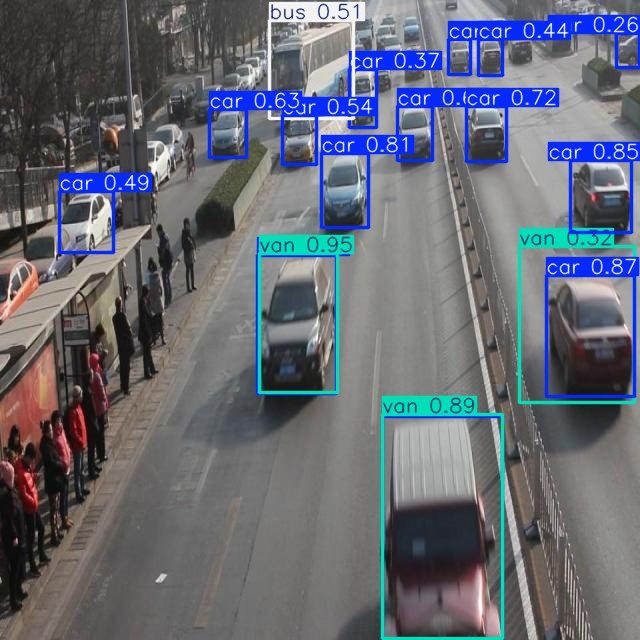

# Báo cáo cá nhân — Ngày 2 Object Detection

Đổi tên file theo `MSSV_HoTen.md`, ví dụ `20241234_NguyenVanAn.md`. Điền kết quả thật, xóa dòng hướng dẫn khi nộp. Xem [quy định nộp](../../SUBMISSION.md).

## 1. Thông tin học viên

- Họ tên: Phạm Văn Dương
- MSSV: 2A202603332
- Email: 26ai.duongpv@vinuni.edu.vn
- Lớp: L2B
- Link repo bài làm: https://github.com/pvd2201/K5-L2B-DAY02-PhamVanDuong-2A202603332-ObjectDetection
- Link Colab đã chạy: https://colab.research.google.com/github/pvd2201/K5-L2B-DAY02-PhamVanDuong-2A202603332-ObjectDetection/blob/main/notebooks/day2_annotation_to_yolo.ipynb

## 2. Schema và mini guideline

Dẫn tới [GUIDELINE_MINI.md](../../GUIDELINE_MINI.md). Tóm tắt ba ca mơ hồ đã quyết định, cách áp dụng schema và phần cần giảng viên làm rõ.
https://github.com/pvd2201/K5-L2B-DAY02-PhamVanDuong-2A202603332-ObjectDetection/blob/main/GUIDELINE_MINI.md

| Ảnh | Tình huống | Quyết định cuối | Lý do theo schema |
| --- | --- | --- | --- |
| `drive_007` |Những xe ở phía trái của box CAR 145 |Không tự gán nhãn, hỏi giảng viên |Car mơ hồ với van/minivan, không có đủ bằng chứng nhận diện |
| `drive_009` |Một chiếc xe nằm giữa hai box TRUCK 198 và CAR 195 |Không tự gán nhãn, hỏi giảng viên |Car mơ hồ với van/minivan, không có đủ bằng chứng nhận diện |
| `drive_011` |Có hai chiếc xe màu trằng nằm phía bên phải của box CAR 252 |Không tự gán nhãn, hỏi giảng viên | Car mơ hồ với van/minivan, không có đủ bằng chứng nhận diện |

## 3. Annotation và self-QC

- Số file nhãn train: 50
- Kết quả checker và lỗi đã xử lý: PASS
- Danh sách ít nhất 10 ảnh đã rà bằng mắt:
drive_002.jpg
drive_003.jpg
drive_005.jpg
drive_009.jpg
drive_011.jpg
drive_012.jpg
drive_014.jpg
drive_019.jpg
drive_026.jpg
drive_028.jpg
- Lỗi bỏ sót/box/class phát hiện khi rà và cách sửa: Lỗi bỏ sót: vẽ thiếu box cho những xe có thể nhận diện. Cách sửa:bổ sung box. Phát hiện một số box chưa ôm sát thân xe, đã điều chỉnh lại.
- Commit khóa nhãn ban đầu: f40afde

## 4. Gold QC và rework

| Chỉ số | Trước sửa | Sau sửa nếu có |
|---|---:|---:|
| TP |478 | |
| FP |568 | |
| FN | 175| |
| Precision | 0.457| |
| Recall | 0.732| |
| F1 |0.5627 | |
| mean_iou_of_matches |0.849| |
| passed |false | |

Không rework. Lý do : file Golden train label đang bị sai. Lab Coach đã hướng dẫn bỏ qua.

## 5. Kết quả YOLO

- Runtime, GPU/CPU, phiên bản Ultralytics và Torch:
Runtime: Google Colab.
GPU: NVIDIA Tesla T4, CUDA:0, VRAM 14.9 GiB.
Python: 3.13.16.
PyTorch: 2.14.1+cu130.
Ultralytics: 8.4.208.
- Các tham số thay đổi so với notebook nếu có và lý do: không có
- Đường dẫn best checkpoint trong phiên chạy:outputs/yolo26_runs/vehicle_annotation/weights/best.pt

| Chỉ số trên 10 ảnh eval | Giá trị |
|---|---:|
| Precision | 0.4071|
| Recall | 0.2340|
| mAP50 |0.2737 |
| mAP50–95 | 0.2018|

Đặt cả 2 folder `assets/eval_predictions/` và `assets/yolo26_runs/` (giải nén từ `day2_colab_outputs.zip`) cạnh báo cáo và dẫn link tương đối. Không chỉ ghi số; chỉ ra ít nhất một ảnh và vật thể cụ thể.

- Thư mục ảnh dự đoán: [eval_predictions](assets/eval_predictions/)
- Thư mục kết quả huấn luyện YOLO: [yolo26_runs](assets/yolo26_runs/)

Ảnh drive_056.jpg : ảnh có những phương tiện là car, bus. Mô hình đã phân loại nhầm 3 box "car" trở thành "van". Mô hình có bỏ sót một số "car" đang đỗ ở phía bên trái.

Trả lời bốn câu hỏi cuối notebook:
1. Lớp nào recall thấp nhất? Ảnh nào minh họa?

Lớp bus có Recall thấp nhất, bằng 0.

2. Nếu mAP50 cao nhưng mAP50–95 thấp, cần kiểm điều gì trên box?

Cần kiểm tra độ chính xác của bounding box:
- Box có bao sát toàn bộ đối tượng không?
- Box có bị quá rộng hoặc quá hẹp không?
- Tọa độ tâm và kích thước box có chính xác không?
- Box có bao gồm quá nhiều phần nền hoặc bỏ sót một phần đối tượng không?
Lý do: mAP50 chỉ yêu cầu IoU đạt ngưỡng 0.50, trong khi mAP50–95 đánh giá ở nhiều ngưỡng IoU nghiêm ngặt hơn. Vì vậy, chênh lệch lớn có thể cho thấy box chưa đủ chính xác về vị trí và kích thước.

3. Lỗi class nào có thể liên quan guideline? Dữ kiện nào hỗ trợ nhận xét?

Các lớp truck, bus và van có thể dễ nhầm lẫn do hình dáng phương tiện tương đối giống nhau.
Trong kết quả eval:
- truck: Recall = 0.200.
- bus: Recall = 0.
- van: Recall = 0.0833.
- car: Recall = 0.660.

Dữ kiện này cho thấy mô hình nhận diện ba lớp phương tiện trên kém hơn đáng kể so với car. Có thể xem lại guideline phân biệt truck, bus và van, đồng thời kiểm tra các trường hợp gán nhãn chưa nhất quán.

4. Vì sao không dùng 10 ảnh eval để train? Vai trò validation của chúng trong notebook là gì?

Không dùng 10 ảnh eval để train nhằm tránh rò rỉ dữ liệu (data leakage), bảo đảm mô hình không học trước các ảnh được dùng để đánh giá.

## 6. Khó khăn và cách xử lý

| Bước/thời điểm | Lỗi quan sát | Cách đã thử | Kết quả/còn thiếu |
|---|---|---|---|
| Đánh giá annotation| Chương trình không tìm thấy gold labels do các file nằm trong thư mục lồng nhau|Kiểm tra cấu trúc gold_train_labels/ và xác định vị trí các file .txt | Đã xác định được nguyên nhân; cần ghi nhận kết quả đánh giá cuối cùng nếu đã chạy lại|

## 7. Tự đánh giá theo rubric

Đối chiếu [RUBRIC.md](../../RUBRIC.md): phần nào đã có kết quả, phần nào còn thiếu hoặc chưa kiểm được. Không tự nhận hoàn thành bước chưa chạy.

| Tiêu chí | Kết quả bài làm | Điểm | Có/Không |
| --- | --- | ---: | :---: |
| Hoàn thành và định dạng YOLO | 50 file cùng basename, 5 cột, normalized, bốn class ID đúng | 10 |Có |
| Đầy đủ vật thể | Gán đủ xe thuộc schema, kể cả xe che/cắt khung có thể nhận diện | 20 | Có|
| Độ bám sát và hình học box | Box sát phần vật thể nhìn thấy, không lấn nền/gộp vật thể | 20 |Có |
| Phân lớp nhất quán | Phân biệt `car/truck/bus/van`, không gán vật thể ngoài scope | 15 |Có |
| Mini guideline và quyết định mơ hồ | Định nghĩa lớp, quy tắc box, ít nhất ba case có lý do | 10 | Có|
| Gold-set annotation QC | `F1 >= 0.80` và `mean IoU >= 0.70` hoặc có vòng rework được giải thích rõ | 15 |Không (F1<=0.80 do file Gold sai>) |
| Pipeline YOLO và phân tích | Colab chạy được, không dùng eval để train, có metrics/ảnh eval và nhận xét lỗi | 10 |Có |

## 8. Công cụ AI và tài liệu tham khảo

Ghi công cụ đã dùng, dùng ở bước nào và phần đã tự kiểm tra; không dùng thì ghi rõ. Liệt kê nguồn ngoài repo được sử dụng. Không ghi mật khẩu/token hoặc đính kèm gold train.

| Công cụ | Mục đích | Phần đã tự kiểm tra |
|---|---|---|
|ChatGPT|Hỗ trợ giải thích lỗi, hướng dẫn sử dụng CVAT, GitHub, Google Colab|Tự thực hiện lại các thao tác theo hướng dẫn, kiểm tra kết quả hiển thị trên CVAT, GitHub và Google Colab.|